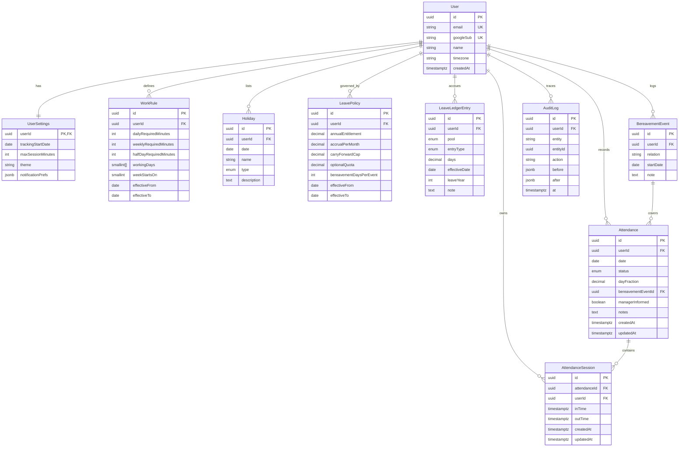

# Office Hours Tracker: Design Document v1

Status: **DRAFT for review. No code written yet.**
Scope of this document: (1) Domain rules, (2) Screen inventory, (3) ER / data design.
Next documents (after approval): visual design, API contract, engine spec + test matrix.

---

## 0. Confirmed inputs

| Topic | Decision |
|---|---|
| User | Single user (personal). `userId` on every table so multi-user stays possible. |
| Timezone | Asia/Kolkata (IST) only. Stored as UTC timestamps, converted for display. |
| Hours | Net time inside office. Daily 8h (480 min), weekly 40h (2400 min). Same for every day type that requires work. |
| Working days | Mon-Fri. Week starts Monday. Sat/Sun = weekly off. |
| Holidays / weekly off | Paid. Required = 0. No work expected. |
| Annual leave pool | 21 days/yr (sick + casual shared). Accrues 1.75 on the 1st of each month. Leave year = Jan-Dec. |
| Carry forward | Max 3 days into next year. Excess lapses on 31 Dec. |
| Leave beyond balance | Allowed but **unpaid (LOP): salary is cut for those days in that month**. App warns before saving, counts LOP days per month, and prepares a message for the manager. |
| Optional leaves | 2 per year, separate pool. |
| Company / festival holidays | Fixed yearly list, separate, not a balance. |
| Bereavement | Up to 5 working days **per event**, separate from the 21, close relatives only. |
| Half day | 0.5 leave. Requires 4h (240 min) worked. |
| WFH | Status only. Counts as a normal working day (required 480). No balance. |
| Precision | Minutes. Seconds discarded on input. |
| Hosting | Netlify (frontend + Netlify Function running Express), Neon PostgreSQL. |
| Login | Google Sign-In with single-email allowlist, HTTP-only session cookie. |

### Opening position (as of 19 Sep 2026)

| Pool | Calculation | Balance |
|---|---|---|
| Annual (sick+casual) | 2.00 carried + 15.75 accrued (9 x 1.75) - 5.00 used | **12.75** |
| Optional | 2 granted - 1 used | **1** |
| WFH days (info only) | 10 taken this year | n/a |
| Bereavement | none used | 5 available per event |

Next annual credit: 1 Oct -> 14.50, 1 Nov -> 16.25, 1 Dec -> 18.00 (before any leave taken).

---

## 1. Domain rules

Each rule is one testable statement. IDs (R-xx) will be referenced by the engine tests.

### 1.1 Time and sessions

- **R-01** A session is one IN and (once closed) one OUT timestamp, stored in UTC, minute precision.
- **R-02** Worked time is the sum of (OUT - IN) of closed sessions, plus (now - IN) for the single open session **of today only**.
- **R-03** Outside time is the gaps between consecutive sessions of the same day (first IN to last OUT). Time before the first IN and after the last OUT is not "outside."
- **R-04** A session belongs to the IST calendar date of its IN, even if OUT is after midnight. It is never split.
- **R-05** OUT must be strictly after IN. A session must be at least 1 minute.
- **R-06** Sessions of one user may never overlap. Touching (OUT 10:00, next IN 10:00) is allowed.
- **R-07** At most one open session per user at any time.
- **R-08** Sanity cap: a single session longer than 16h is rejected ("Please check the date/time"). Configurable.
- **R-09** An open session whose IN date is before today is **INCOMPLETE**: it contributes 0 minutes, the day is flagged "needs fix," and totals exclude it until an OUT is entered.
- **R-10** The backend is the authority for "now". The frontend may tick a timer locally but reconciles from the server.

### 1.2 Day type resolution

Order of precedence for a date:

1. Explicit `Attendance.status` if the user set a leave/WFH status.
2. `Holiday` of type COMPANY on that date -> HOLIDAY.
3. Saturday/Sunday (per rule's working days) -> WEEKLY_OFF.
4. Otherwise -> WORKING.

Additional rules:

- **R-11** An OPTIONAL holiday not taken is a normal WORKING day. It becomes non-working only if the user records `OPTIONAL_HOLIDAY` on that date, and the date must exist in the holiday list as OPTIONAL.
- **R-12** Leave (casual/sick/bereavement/optional) cannot be applied on a HOLIDAY or WEEKLY_OFF date. A leave range spanning a weekend deducts only working days.
- **R-13** A past working day with no attendance record is **UNRECORDED**: worked 0, required 480, flagged. It counts as a shortfall until the user fixes it. Days before the tracking start date are ignored.
- **R-14** Working on a HOLIDAY/WEEKLY_OFF/full-leave day is allowed but warned. Those minutes are stored, shown separately as "worked on off-day," and **excluded** from balance and overtime.

### 1.3 Required minutes per day

| Day type | Required |
|---|---|
| WORKING, WFH | 480 |
| Half-day leave | 240 (worked minutes still count) |
| Full leave, HOLIDAY, WEEKLY_OFF, OPTIONAL_HOLIDAY (taken), BEREAVEMENT | 0, balance N/A |

- **R-15** The value 480 comes from the `WorkRule` effective on that date, never a global constant.

### 1.4 Balance and overtime

- **R-16** Day balance = worked - required (only for days with required > 0 or half-day).
- **R-17** Day overtime = max(0, day balance).
- **R-18** Weekly required = sum of daily required for the Mon-Sun week (only days on/after tracking start). So one leave day makes that week 32h.
- **R-19** Weekly balance = weekly worked - weekly required. Shortfall on one day is **not** forced to be made up that day.
- **R-20** Weekly overtime = max(0, weekly balance). Daily and weekly overtime are reported separately and **never added together**.
- **R-21** Monthly totals sum calendar-month days only. Weeks straddling a month boundary are split by date.
- **R-22** Remaining today = max(0, required - worked). Expected OUT = now + remaining, only while inside. While outside: "If you return now, expected OUT = X."
- **R-23** "Can I leave now?": worked < required -> "You need N more minutes." worked = required -> "Today's required hours are completed." worked > required -> "Xh Ym completed, Zm overtime."
- **R-24** Thursday/Friday nudge (informational): if the weekly balance is negative, show how much is left to reach weekly required.

### 1.5 Work rules

- **R-25** `WorkRule` rows are effective-dated and versioned. Editing means closing the old rule (`effectiveTo`) and creating a new one. Past dates always resolve to the rule in force that day.
- **R-26** Two rules for one user may not overlap in date range (DB constraint).
- **R-27** A date with no applicable rule is an error state in the engine, never a silent default.

### 1.6 Leave pools

- **R-28** Annual pool balance = opening/carry + accruals - lapses + adjustments - usage (usage derived from attendance).
- **R-29** Accrual: +1.75 on the 1st of each month of the leave year.
- **R-30** Year end: on 31 Dec, LAPSE = max(0, balance - 3). The remaining (<= 3) continues into January. The balance never goes below 0 (see R-32), so there is no debt to carry.
- **R-31** Leave usage: full day = 1.0, half day = 0.5. Carried-forward days are consumed first (implicit, since the pool is one continuous balance and lapse only trims excess at year end).
- **R-32** Leave beyond balance is **LOP (loss of pay)**. Leave days are allocated to the balance in date order. Any part that the balance at that date cannot cover becomes LOP (derived, not stored). The balance floors at 0. Before saving, the app shows "N day(s) will be unpaid (salary cut)" and offers a pre-filled manager message. A `managerInformed` flag is stored on the attendance record. Not blocked.
- **R-32a** LOP days are reported per calendar month ("Sep 2026: 1.5 LOP days") on the Leave screen and the monthly summary, so you can check them against your payslip. Accruals on the 1st never reverse a past LOP day.
- **R-33** Optional pool: 2 granted on 1 Jan. Usage derived from `OPTIONAL_HOLIDAY` days. Unused optional leaves lapse on 31 Dec (assumption, see section 4).
- **R-34** Bereavement: no balance. Each event allows up to 5 working days, enforced per event. Does not touch the annual or optional pool.
- **R-35** Nov and Dec banner: "X annual leaves left, only 3 carry forward, Y will lapse."

### 1.7 Integrity

- **R-36** Backend validates everything. Frontend validation is convenience only.
- **R-37** One attendance record per user per date (unique).
- **R-38** Stored: sessions, day status, notes, rules, holidays, ledger entries. **Never stored**: worked, outside, balance, overtime, weekly/monthly totals, expected OUT.
- **R-39** Edits and deletions of sessions/attendance write an audit entry (before/after).
- **R-40** Duplicate requests are made harmless by DB constraints (one open session, no overlap). The UI treats "already checked in/out" as "refetch and show current state."

### 1.8 Holiday calendar and import

- **R-41** Holidays can be added one by one or imported from a file. Import formats: **CSV** and **Excel (.xlsx)** in MVP, **ICS** later. A downloadable template (`date, name, type, description`) is provided.
- **R-42** Import is two-step: **preview** (nothing saved) then **commit**. The preview shows each row as New, Duplicate (same date already exists), or Error (bad date, unknown type, empty name, duplicate inside the file).
- **R-43** For duplicates the user chooses per import: Skip existing, or Overwrite existing. Default is Skip.
- **R-44** Commit is one transaction. If it fails, nothing is saved. Rows with errors are never imported.
- **R-45** `type` accepts COMPANY or OPTIONAL. Festival holidays are stored as COMPANY. A blank type defaults to COMPANY.
- **R-46** A holiday added or removed changes past and future calculations for that date, so the app shows the number of affected days and asks for confirmation when the date is in the past.
- **R-47** A default starter list is not shipped, because the list differs per company and year. The app opens with the import screen and the template instead.

---

## 2. Screen inventory (no visuals yet)

Navigation (mobile bottom bar): **Today, Calendar, Leave, Summary, More**.
Desktop: left sidebar with same items plus More expanded.

| # | Screen | Purpose | Data shown | Main actions |
|---|---|---|---|---|
| 1 | Login | Google sign-in | Sign-in button, error if email not allowed | Sign in |
| 2 | **Today (Dashboard)** | Daily use, must be fastest | Status (Inside/Outside/Not started/Leave/Holiday/WFH/Off), live worked, required, remaining, expected OUT, overtime, "Can I leave?", today's sessions, this week worked/required/balance, leave balance chip, incomplete-day banner, Thu/Fri nudge, Nov/Dec lapse banner | Check In/Out, add manual session, set day status |
| 3 | Day Detail (`/day/:date`) | Full view/edit of any date | Status, required, worked, balance, overtime, sessions, outside gaps, first IN, last OUT, notes, warnings (incomplete, off-day work) | Add/edit/delete session, change status, half-day, notes, manager informed flag |
| 4 | Session form (sheet) | Add/edit a session | IN date+time, OUT date+time, live validation messages | Save, delete |
| 5 | Calendar | Month overview | Colour per day (met/short/WFH/leave/holiday/off/incomplete/unrecorded), month totals strip | Tap day -> Day Detail, change month |
| 6 | History | Search past days | List with filters: date range, status, completed/short/overtime/WFH/leave/holiday/incomplete | Open day |
| 7 | Weekly Summary | Week view | Required, worked, balance, overtime, day rows, counts (working/leave/WFH/holiday/off) | Prev/next week |
| 8 | Monthly Summary | Month view | Same as weekly plus chart, overtime, leave taken | Prev/next month, export |
| 9 | **Leave** | Balances and applying | Annual balance, optional balance, bereavement events, accrual/lapse ledger, year-end lapse warning | Apply leave (single/range/half), log bereavement event, advance-leave notice + copy manager message |
| 10 | Holidays | Yearly calendar list | Date, name, type COMPANY/OPTIONAL, description, count of holidays and optional quota used | Add/edit/delete, **Import (upload CSV/Excel), download template** |
| 10a | Holiday Import (sheet) | Bulk load a year's calendar | File picker, preview table with New/Duplicate/Error per row, summary counts | Choose Skip/Overwrite for duplicates, Commit, Cancel |
| 11 | Work Rules | Rule versions | Current and past rules with effective dates | Add new version (closes old) |
| 12 | Reports / Export | Data out | Range picker, preview | CSV (MVP), Excel/PDF (later) |
| 13 | Settings | Preferences | Theme, tracking start date, session cap, notification prefs (future), account | Save, JSON backup export, import |

Global elements: offline/API-error banner, loading skeletons, empty states, confirm dialogs for delete, toast messages.

Every screen must define these states during visual design: loading, empty, error, offline, and normal.

---

## 3. ER / data design

### 3.1 Entity relationship diagram

### 3.2 Enums

- `AttendanceStatus`: `WORKING`, `WFH`, `CASUAL_LEAVE`, `SICK_LEAVE`, `BEREAVEMENT_LEAVE`, `OPTIONAL_HOLIDAY`
  (HOLIDAY and WEEKLY_OFF are **derived** from the calendar, never stored, so they cannot drift.)
- `HolidayType`: `COMPANY`, `OPTIONAL`
- `LeavePool`: `ANNUAL`, `OPTIONAL`
- `LedgerEntryType`: `OPENING` (carry/opening balance), `ACCRUAL`, `GRANT`, `LAPSE`, `ADJUSTMENT`
  (Leave **usage is not a ledger type**. It is derived from attendance rows, so there is one source of truth.)

### 3.3 Key design decisions

1. **Usage derived, everything else ledgered.** A leave day exists in exactly one place (Attendance). The ledger only holds things that can't be derived: opening balance, accruals, grants, lapses, and manual adjustments. Balance = sum(ledger) - usage from attendance. This prevents the two ever disagreeing.
2. **Lazy, idempotent ledger materialization.** Netlify has no reliable cron for a hobby setup. On the first request of a new day/month/year, the API ensures missing ACCRUAL / GRANT / LAPSE rows exist. A unique key `(userId, pool, entryType, leaveYear, month)` makes this safe to run any number of times.
3. **`userId` on sessions** (denormalized from attendance) so the DB can enforce no-overlap and one-open-session across all of a user's sessions.
4. **Derived day types.** Holiday/weekly-off come from `Holiday` and `WorkRule.workingDays`. Only user-chosen statuses are stored.
5. **Half day** is `dayFraction` (1.0 or 0.5) on the attendance row, allowed only for leave statuses.
6. **Audit log** is small but is what keeps you trusting your numbers ("why did Tuesday change?").
7. **No IdempotencyKey table in MVP.** DB constraints already make duplicate IN/OUT harmless.
8. **Minutes and decimals:** durations in integer minutes. Leave days in `Decimal(5,2)`. Never floats.

### 3.4 Constraints (including raw-SQL ones Prisma can't express)

| Constraint | How |
|---|---|
| One attendance per user/date | `UNIQUE (userId, date)` |
| OUT after IN | `CHECK (outTime IS NULL OR outTime > inTime)` |
| One open session per user | Partial unique index: `UNIQUE (userId) WHERE outTime IS NULL` |
| No overlapping sessions | `EXCLUDE USING gist (userId WITH =, tstzrange(inTime, COALESCE(outTime,'infinity'), '[)') WITH &&)`, needs `btree_gist` extension (supported on Neon) |
| Session date matches attendance date | Validated in transaction (IST date of `inTime` = `Attendance.date`) |
| No overlapping work rules | `EXCLUDE USING gist (userId WITH =, daterange(effectiveFrom, effectiveTo, '[]') WITH &&)` |
| One holiday per user/date | `UNIQUE (userId, date)` |
| Idempotent ledger rows | `UNIQUE (userId, pool, entryType, leaveYear, effectiveDate)` for ACCRUAL/GRANT/LAPSE |
| Half-day only on leave | `CHECK (dayFraction = 1.0 OR status IN ('CASUAL_LEAVE','SICK_LEAVE'))` (bereavement/optional are whole days) |
| Bereavement link | `bereavementEventId` required iff status = `BEREAVEMENT_LEAVE` (`CHECK`). Max 5 days/event validated in transaction |
| Transactions | Check-in, check-out, session edit, leave apply all run in one transaction with the above checks |

Indexes: `Attendance(userId, date)`, `AttendanceSession(attendanceId)`, `AttendanceSession(userId, inTime)`, `LeaveLedgerEntry(userId, pool, effectiveDate)`, `Holiday(userId, date)`.

### 3.5 Leave ledger walkthrough with your real numbers

**Annual pool, 2026**

| Date | Type | Days | Running |
|---|---|---|---|
| 01-Jan | OPENING (carried from 2025) | +2.00 | 2.00 |
| 01-Jan to 01-Sep | 9 x ACCRUAL | +1.75 each (15.75) | 17.75 |
| 19-Sep | ADJUSTMENT ("5 leaves taken before tracking began") | -5.00 | **12.75** |
| 01-Oct | ACCRUAL | +1.75 | 14.50 |

If on 31-Dec the balance is 7.00:

| Date | Type | Days | Running |
|---|---|---|---|
| 31-Dec | LAPSE (7.00 - 3 cap) | -4.00 | 3.00 |
| 01-Jan-2027 | ACCRUAL | +1.75 | **4.75** |

**Optional pool, 2026**

| Date | Type | Days | Running |
|---|---|---|---|
| 01-Jan | GRANT | +2.00 | 2.00 |
| 19-Sep | ADJUSTMENT (1 used before tracking) | -1.00 | **1.00** |
| 31-Dec | LAPSE (remaining) | -remaining | 0 |

**LOP example**: balance 0.50, apply 2 casual leave days on 24-25 Nov. The first day uses 0.50 paid and 0.50 is LOP; the second day is 1.00 LOP. The app warns "1.50 day(s) will be unpaid (salary cut)," prepares the manager message (copy or mailto), and you tick `managerInformed`. The balance stays at 0. November shows "LOP: 1.5 days." The 1 Dec accrual (+1.75) is available for future leave and does not reverse the November LOP.

### 3.6 What is stored vs derived

| Stored | Derived on read |
|---|---|
| Sessions (IN/OUT) | Worked, outside, first IN, last OUT |
| Day status, fraction, notes, managerInformed | Required, balance, overtime |
| WorkRule versions | Which rule applied on a date |
| Holidays | HOLIDAY / WEEKLY_OFF day types |
| Ledger: opening, accrual, grant, lapse, adjustment | Leave usage, current balance, advance flag |
| Audit log | Weekly / monthly totals, expected OUT |

---

## 4. Assumptions to confirm

1. **Optional leaves lapse on 31 Dec** (no carry forward). You only mentioned carry forward for the 21. *(default accepted)*
2. **LOP is final and the balance floors at 0** (no debt carried). *(confirmed by you: salary is cut for that month, and later accruals do not reverse it)*
3. **Unrecorded past working days** count as a 480-minute shortfall (flagged) until fixed, rather than being ignored. *(default accepted)*
4. **Optional-leave days must exist in the holiday list** as type OPTIONAL when recorded. *(confirmed by you)*
5. **Tracking start date** is the day you first use the app. Leave and WFH before then come from the opening balance, and hours before then are not tracked.
6. **Work rule effective date**: 01-Sep-2026 for 8h/40h.
7. **Session cap** of 16h per session.
8. **Full-leave day with sessions** is treated like off-day work: warned and excluded from balance.

---

## 5. Risks and how the design handles them

| Risk | Handling |
|---|---|
| Numbers drift after edits | Nothing derived is stored |
| Forgot OUT inflates hours | R-09: past open sessions count 0 and are flagged |
| Double tap / two devices | DB partial unique + exclusion constraint |
| Leave balance mismatch | Usage derived from attendance, one source |
| Rule change rewrites history | Versioned effective-dated rules, no overlap |
| Public URL abused | Google sign-in + email allowlist + HTTP-only cookie |
| Serverless cold start / pooling | Neon pooled connection, Prisma tuned for serverless |
| Wrong date/timezone | UTC storage, IST conversion in one utility only, engine takes `now` as input |
| Lost data | Neon point-in-time backup + manual JSON export |
